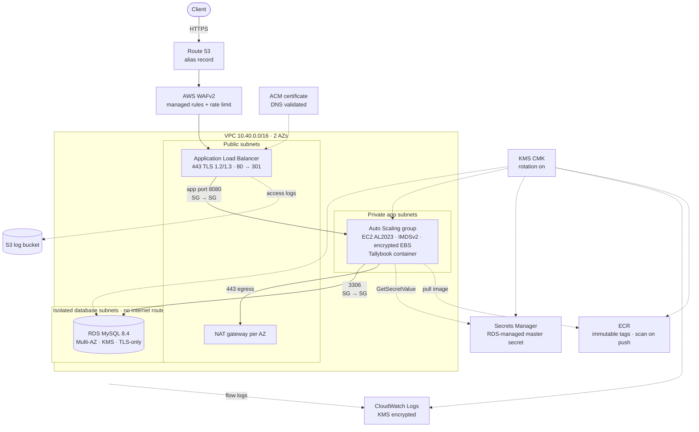

# aws-alb-asg-rds-terraform-platform

Production-style **two-tier AWS platform** written as modular Terraform: an internet-facing
Application Load Balancer and an Auto Scaling group of hardened EC2 instances in private subnets
(web tier), backed by an encrypted Multi-AZ **Amazon RDS for MySQL** instance in isolated subnets
(data tier). WAFv2, ACM, Route 53, KMS, Secrets Manager, VPC flow logs and an S3 remote-state
backend are wired in from day one.

The workload is **Tallybook**, a small Flask + MySQL expense ledger. It runs on the web tier from
an ECR image, and the whole two-tier shape can be reproduced locally with Docker Compose
(proxy → two web replicas → MySQL).

> Inspired by [DevOps-Project-11 in NotHarshhaa/DevOps-Projects](https://github.com/NotHarshhaa/DevOps-Projects/tree/master/DevOps-Project-11)
> (two-tier AWS architecture with Terraform). This repository is an independent implementation:
> the module layout, security model, application, tests and tooling are my own.

---

## Architecture



### What each module owns

| Module | Resources | Key decisions |
| --- | --- | --- |
| `modules/network` | VPC, 3 subnet tiers × 2–3 AZs, IGW, NAT per AZ (or one shared), route tables, flow logs | Database subnets have **no** default route; default security group is stripped of all rules |
| `modules/security` | ALB, web and DB security groups with per-rule resources | Every hop references the previous security group, never a CIDR; DB group has no egress |
| `modules/database` | RDS MySQL, subnet group, parameter group, log groups, enhanced monitoring role | `manage_master_user_password` (password never in Terraform), `require_secure_transport=1`, IAM auth, Multi-AZ, deletion protection, PI + logs encrypted with the CMK |
| `modules/web` | ALB, HTTPS + redirect listeners, target group, launch template, ASG, CPU target tracking, instance role, access-log bucket | IMDSv2 with hop limit 1, no SSH key (SSM Session Manager), encrypted gp3 root volume, rolling instance refresh with auto rollback |
| `modules/edge` | ACM certificate + DNS validation, Route 53 alias, WAFv2 web ACL + logging | AWS Common, Known Bad Inputs and SQLi rule groups, per-IP rate limit, auth/cookie headers redacted from WAF logs |
| root (`infra/terraform`) | KMS key + alias, ECR repository + lifecycle, module wiring | One CMK whose key policy also covers CloudWatch Logs and the Auto Scaling service-linked role |
| `infra/bootstrap` | S3 state bucket (versioned, KMS, TLS-only policy) | Native S3 lock files (`use_lockfile`), no DynamoDB table needed |

### Boot sequence of a web instance

1. The launch template resolves the latest Amazon Linux 2023 arm64 AMI from the public SSM parameter.
2. `user-data.sh.tftpl` installs Docker, downloads the regional RDS CA bundle and reads the
   RDS-managed secret from Secrets Manager using the instance role.
3. It logs in to ECR and starts the Tallybook container read-only, with `no-new-privileges`,
   publishing port 8080 to the ALB.
4. The ALB target group probes `/healthz`; the ASG uses ELB health checks and replaces failing instances.

---

## Repository layout

```text
.
├── app/                     # Tallybook (Flask, SQLAlchemy Core, PyMySQL) + pytest suite
├── proxy/nginx.conf         # Local ALB stand-in
├── compose.yaml             # proxy → web ×2 → MySQL 8.4 on internal networks
├── Dockerfile               # Multi-stage, non-root, health-checked image
├── infra/
│   ├── bootstrap/           # Remote state bucket (run once per account)
│   └── terraform/
│       ├── modules/{network,security,database,web,edge}
│       ├── envs/*.tfvars.example
│       ├── backend.hcl.example
│       └── tests/           # terraform test suites + shared AWS mocks
├── scripts/                 # check-all, compose smoke test, user-data renderer
├── .github/workflows/ci.yml # Validation-only pipeline definition
├── .pre-commit-config.yaml
└── Makefile
```

---

## Prerequisites

| Tool | Version used |
| --- | --- |
| Terraform | 1.17.x (code requires ≥ 1.10 for S3 native locking) |
| AWS provider | 6.x |
| TFLint + AWS ruleset | 0.66 / 0.34 |
| Checkov, Trivy | 3.4, 0.76 |
| Python | 3.13 |
| Docker + Compose v2 | 26.x / 2.26 |
| hadolint, shellcheck, actionlint, gitleaks | any recent release |

---

## Step-by-step setup

```bash
git clone https://github.com/shubhamkhedkar/aws-alb-asg-rds-terraform-platform.git
cd aws-alb-asg-rds-terraform-platform

# Python tooling for the app
python3 -m venv .venv && . .venv/bin/activate
pip install -r app/requirements-dev.txt

# Optional: git hooks (fmt, validate, tflint, checkov, ruff, hadolint, shellcheck, gitleaks)
pip install pre-commit && pre-commit install

# Every quality gate in one go (no AWS credentials needed)
make check
```

`make check` runs `scripts/check-all.sh`: terraform fmt / init `-backend=false` / validate for both
stacks, `terraform test` against a mocked AWS provider, TFLint, Checkov, Trivy config scanning,
ruff + pytest with a 90 % coverage gate, `pip-audit`, hadolint, shellcheck (including the rendered
user-data script), actionlint, `docker compose config` and gitleaks.

### Terraform tests without AWS

```bash
make tf-test
```

The suites in `infra/terraform/tests/` use `mock_provider "aws"` with shared fake data in
`tests/mocks/aws.tfmock.hcl`, so they never call AWS. They cover:

- **network** – subnet counts and CIDR plan, no public IP auto-assignment, NAT per AZ vs shared NAT, flow logs, input validation
- **security** – SG-to-SG references for ALB → web → DB, port scoping, per-CIDR client rules
- **database** – private, encrypted, RDS-managed secret, TLS-only parameter group, Multi-AZ/backups/deletion protection, input validation
- **web** – IMDSv2 + hop limit, encrypted EBS, no SSH key, secret fetched at boot, ELB health checks, TLS policy, HTTP → HTTPS redirect, ALB access logs
- **stack** – full wiring of all modules, KMS rotation, immutable/scanned ECR, AZ selection, variable validation

---

## Run it locally

The compose stack mirrors the two tiers: `proxy` (ALB stand-in) is the only published service,
`web` runs two replicas like the ASG, and `db` sits on an internal network like the isolated subnets.

```bash
cp .env.example .env          # change the local passwords
make up                       # docker compose up -d --build --wait
curl -s localhost:8088/healthz
curl -s -X POST localhost:8088/api/entries -H 'Content-Type: application/json' \
  -d '{"description":"Groceries","amount":"450.50","category":"groceries"}'
curl -s localhost:8088/api/summary
open http://localhost:8088/   # HTML view, shows which replica served the page
make down                     # stop and delete the volume
```

`make smoke` does all of that unattended with throwaway credentials: health and readiness,
write + read paths against MySQL, validation errors, load spread across both replicas, data
surviving a web tier restart, and a network check that the proxy cannot reach the database.

### API

| Method | Path | Purpose |
| --- | --- | --- |
| GET | `/healthz` | Liveness (ALB target group health check) |
| GET | `/readyz` | Readiness: 200 when MySQL answers, 503 otherwise |
| GET | `/api/entries?category=&limit=` | Latest entries, newest first |
| POST | `/api/entries` | Create an entry (`description`, `amount`, `category`, `spent_on`) |
| DELETE | `/api/entries/<id>` | Delete an entry |
| GET | `/api/summary` | Totals per category and overall |
| GET | `/` | HTML dashboard |

---

## How I would deploy it to AWS

Nothing in this repository has been applied to an AWS account. When I roll it out, the order is:

1. **Credentials** – use an SSO/IAM Identity Center profile for the target account
   (`export AWS_PROFILE=...`), never long-lived keys.
2. **State backend** – `cd infra/bootstrap && terraform init && terraform apply`, then copy
   `infra/terraform/backend.hcl.example` to `backend.hcl` with the bucket name from the output.
3. **Variables** – copy `envs/prod.tfvars.example` to `envs/prod.tfvars` and set `domain_name` and
   `hosted_zone_name` to a Route 53 public zone I own.
4. **Image registry first** – create only the repository, then build and push the image:
   ```bash
   cd infra/terraform
   terraform init -backend-config=backend.hcl
   terraform apply -var-file=envs/prod.tfvars -target=aws_ecr_repository.app
   aws ecr get-login-password | docker login --username AWS --password-stdin <repo-url>
   docker buildx build --platform linux/arm64 -t <repo-url>:1.0.0 --push ../..
   ```
5. **Full stack** – `terraform plan -var-file=envs/prod.tfvars -out=prod.tfplan`, review, then
   `terraform apply prod.tfplan`. Expect ~15–20 minutes, mostly RDS Multi-AZ creation.
6. **Verify** – open the `app_url` output, check target health in the console, and connect to an
   instance with `aws ssm start-session` if needed.
7. **Releases** – push a new immutable tag, set `app_image_tag`, and apply; the ASG instance
   refresh rolls instances 50 % at a time with automatic rollback.

For a cheaper non-production environment use `envs/dev.tfvars.example` (single NAT gateway,
single-AZ `db.t4g.micro`, one instance, deletion protection off).

---

## Limitations and trade-offs

- **Not applied to a real account.** Validation is static analysis plus mocked `terraform test`;
  the mocks prove wiring and policy, not that AWS accepts every argument combination.
- **NAT egress instead of VPC endpoints.** The web tier reaches ECR, SSM and Secrets Manager
  through NAT on port 443. Interface endpoints would remove that path at extra hourly cost.
- **Secret read at boot.** Instances read the DB password once at launch; after an RDS-managed
  rotation the containers need a restart (an instance refresh) or a sidecar that re-reads it.
- **No CloudFront.** WAF sits directly on the ALB because the app is dynamic; a CDN would only
  help for static assets.
- **The application uses the master user.** A dedicated least-privilege MySQL user (or IAM
  database authentication, which is already enabled on the instance) is the next hardening step.
- **ALB access logs use SSE-S3.** ALB log delivery does not support SSE-KMS.
- The CI workflow is a definition only; GitHub Actions is disabled on this repository.

Every accepted scanner finding is suppressed inline next to the resource with a written reason
(`#checkov:skip=` / `# trivy:ignore:`), so `make check` stays strict.

---

## Cleanup

Local:

```bash
make down    # removes containers, networks and the MySQL volume
```

AWS (only if it was deployed):

```bash
cd infra/terraform
# Deletion protection is on by default for the ALB and RDS: set deletion_protection = false and apply first.
terraform apply -var-file=envs/prod.tfvars -var deletion_protection=false
terraform destroy -var-file=envs/prod.tfvars
# RDS writes a final snapshot (tally-<env>-final); delete it manually when no longer needed.
# Empty the ALB log bucket before destroy, or the bucket deletion will fail.
# The state bucket in infra/bootstrap has prevent_destroy and is removed last, by hand.
```

---

## Credits

- Original project idea: [NotHarshhaa/DevOps-Projects – DevOps-Project-11](https://github.com/NotHarshhaa/DevOps-Projects/tree/master/DevOps-Project-11)
- Built and maintained by [Shubham Khedkar](https://github.com/shubhamkhedkar) · MIT licensed
